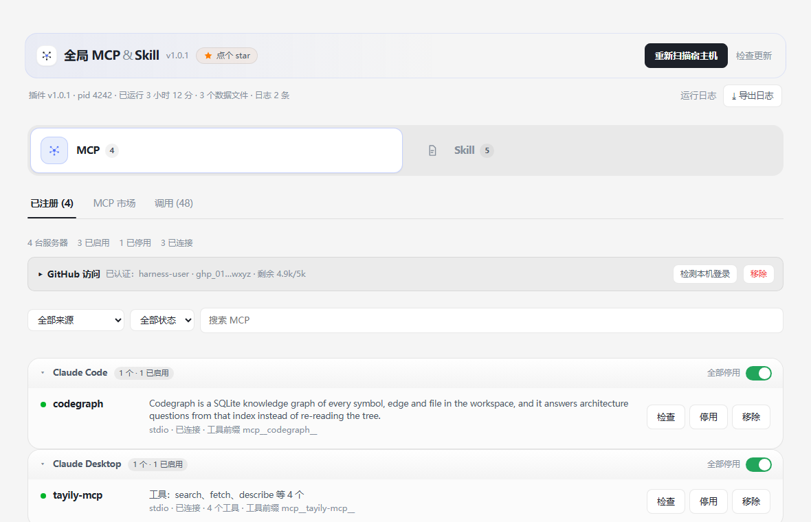
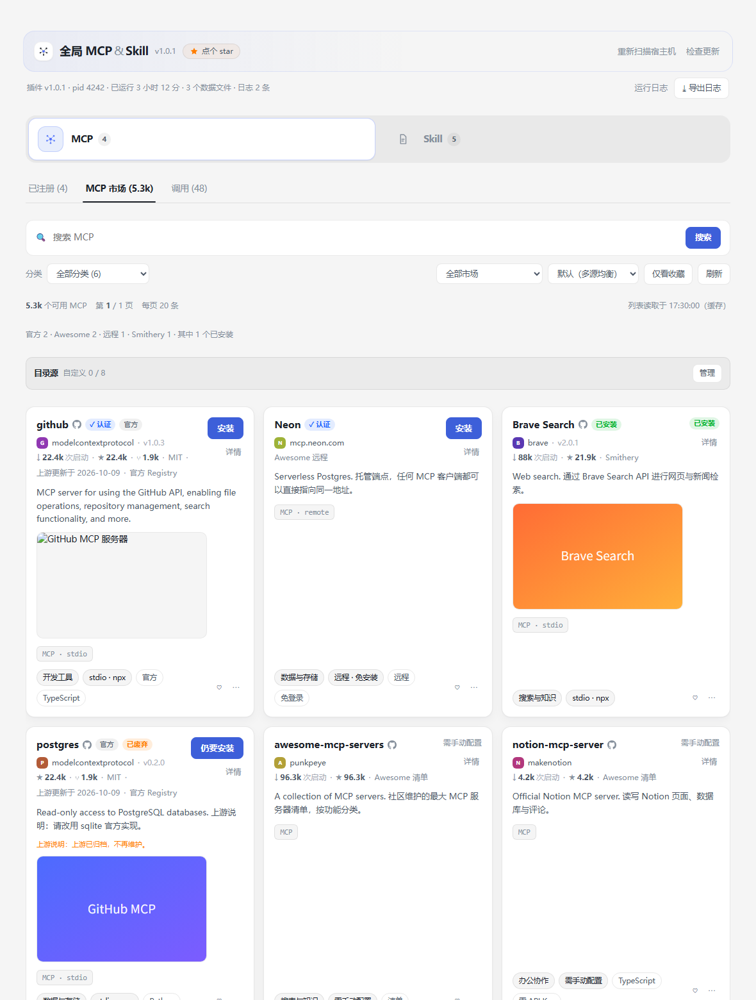
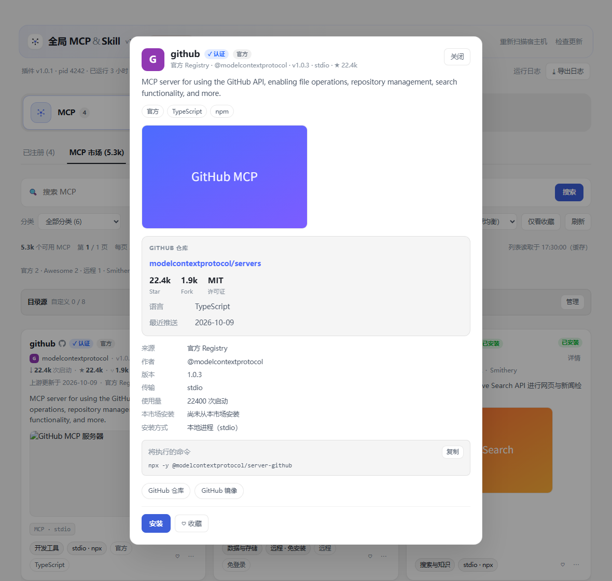
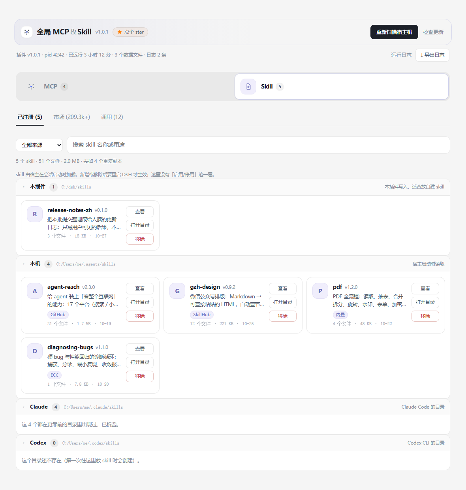
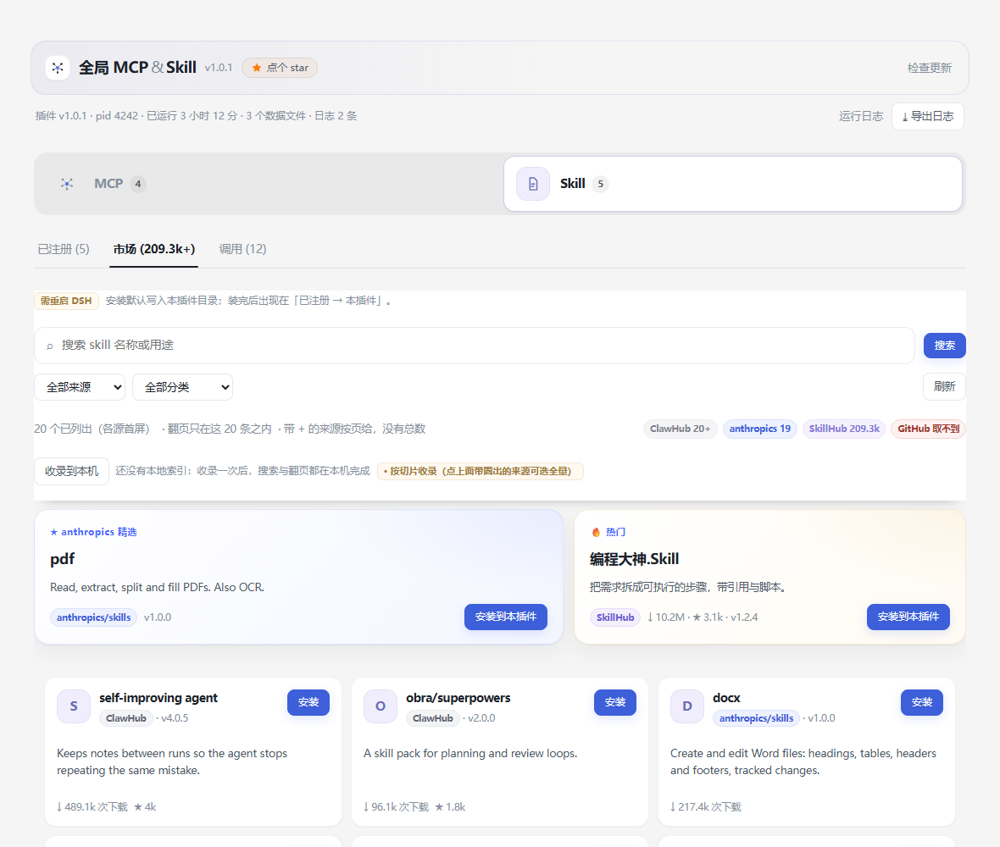
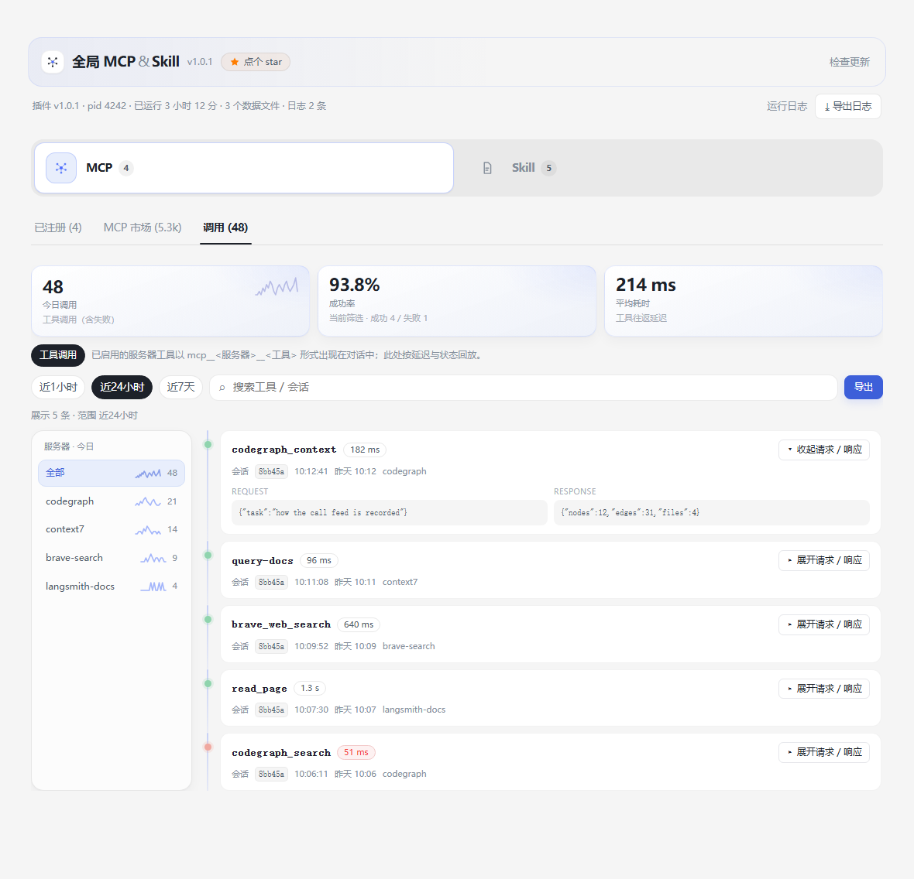

<p align="center">
 
</p>

<h1 align="center">全局 MCP &amp; Skill</h1>

<p align="center"><a href="README.zh-CN.md">中文</a> | English</p>

<p align="center">
 <a href="CHANGELOG.md"></a>
 <a href="LICENSE"></a>
 =24">
</p>

**One panel in DeepSeek Harness for both halves of "what this machine can do": MCP servers and Skills.** It scans every MCP configuration on the host and registers what it finds, puts six open MCP catalogues and four skill marketplaces behind one search box, keeps a local index of both so paging, search and install need no network, and records what actually ran — tool round trips and skill triggers — so "configured" and "used" stop being the same word.

The panel registers itself in the sidebar as **全局 MCP & Skill**, directly under *Plugins* (`order: 5` in `sidebar.panellist`).

## At a glance

| | |
|---|---|
| **已注册** | Every server found in the host's MCP configs, grouped by which file it came from; enable, disable, remove, reveal. |
| **MCP 市场** | Six catalogues (official registry, Smithery, Docker MCP, GitHub MCP, awesome-remote, awesome-list) deduplicated into one list; search, category, one-click install. |
| **Skill 空间** | Skills read from four roots (`~/skills`, `~/.agents/skills`, `~/.claude/skills`, `~/.codex/skills`), grouped by origin, with open-folder and a move-to-trash remove. |
| **Skill 市场** | ClawHub, SkillHub, the official set and GitHub, asked at once; install unpacks the archive itself. |
| **调用** | What actually ran: `tool/call` → `tool/result` round trips, plus every skill trigger (the `skill` tool and the `/name` you type). Today's count, success rate, latency, a 1 h / 24 h / 7 d window. |
| **索引** | A local 收录 index of SkillHub, ClawHub and GitHub — slice, or a source walked to its end. Once it holds rows, paging and search read the file (zero requests). |

## Screenshots

These are the real panel: `client/client.js` rendered over a fixed fixture, so the pictures cannot drift from what the code draws.

### 已注册 — servers grouped by where they came from



### MCP 市场 — six catalogues behind one search box



### Detail — everything behind one card



### Skill 空间 — the same page, switched by one pill



### Skill 市场 — four marketplaces, one box



### 调用 — what actually ran



## Install

```sh
git clone https://github.com/YunzhouLi-hub/dsh-overall-mcp.git
dsh plugin --profile <profile> add /path/to/dsh-overall-mcp
# restart DSH: host code loads at startup, the panel reloads with the page
```

- **Node** `^22.19.0 || >=24.0.0`.
- **GitHub access is optional** but changes what two features can do: a stored token (or `gh auth login`) gives 30 search requests a minute, code search, and a full GitHub crawl on its own quota. Without one, browsing falls back to repository search and the panel shows GitHub's own 403 when the 10-a-minute quota runs out.
- The plugin's self-update compares this package against npm; a git checkout is skipped by design — update with `git pull` and a restart.

## What it writes — and what it never touches

Everything it owns lives under `$DSH_HOME/overall-mcp/`:

| File | What it is |
|---|---|
| `registry.json` | The registered servers, their source, version, transport and mount state. |
| `catalog-cache.json` | The last MCP catalogue per source (read instead of the network until it ages out). |
| `skills-index.json` | The 收录 index: rows, per-source cursors, `modes`, `truncations`, `minStars`. |
| `calls.jsonl` | The 调用 feed, one line per round trip / trigger. Every invocation is kept; folding repeats into one row is a read-time decision. |
| `ui-prefs.json` | Display preferences only (the fold window). It never holds configuration. |
| `events.ndjson` | The action log the page header expands. |
| `skills-trash/<time>/` | Where 移除 moves a skill folder — moved, never deleted. |

It **reads** the host's MCP configuration files and never writes them; it writes new skills into `$DSH_HOME/skills/<name>/` and says the exact path.

## HTTP API

The panel talks to these routes (Connection-authenticated; they exist for the page, not as a public API):

```
GET  /status           GET  /registry        GET  /catalog
POST /scan             GET  /skills          GET  /skills/market
POST /skills/market/install                   POST /skills/market/walk   {action: start|stop}
GET  /calls?space=mcp|skill&range=1h|24h|7d&merge=<ms>&filter=&q=
GET|POST /prefs        GET  /events          GET  /favorites
POST /install          POST /toggle          POST /remove               POST /self-update
```

## Measured 2026-10

Numbers the panel reports, and what they mean:

- **SkillHub, full crawl**: 2,107 requests over 43 minutes produced **205,037 rows** of an upstream total of 210,612. The listing drifts while it is being paged, so 2,107 pages × 100 rows dedupe to 205k; the file records `modes.skillhub = "full"` and its cursor `done`.
- **GitHub, slice**: **7,722 repositories** at ≥ 5★. GitHub's search cannot page past 1,000 results, so the walk descends through star bands; seven bands were wider than one window and are recorded in the file's `truncations` rather than quietly dropped.
- **ClawHub, slice**: 1,988 rows. ClawHub publishes no total, and the panel does not invent one.
- **The index as a whole**: 214,747 rows, 163 MB, `complete: true`. Paging, search and install read it with zero network requests.

## Limits it admits

- GitHub search: 10 requests a minute anonymously, 30 with a token; a full crawl paces at 6.5 s per request on purpose.
- SkillHub full crawl pages a drifting listing, so the row count is what arrived, not a promise about the catalogue.
- The index is a cache, not a mirror: `truncations` is where a source says it stopped before the end, and `modes` says which sources were walked to their end.

## Development

This repository is the published plugin: `index.js`, `lib/`, `client/`, the profile patch, `registry.json`, the two READMEs, `CHANGELOG.md` and the pictures. The test suites, render probes and build tooling live in the development workspace and are not part of this repository.

## License

MIT — see [LICENSE](LICENSE). Changes per release are in [CHANGELOG.md](CHANGELOG.md).
