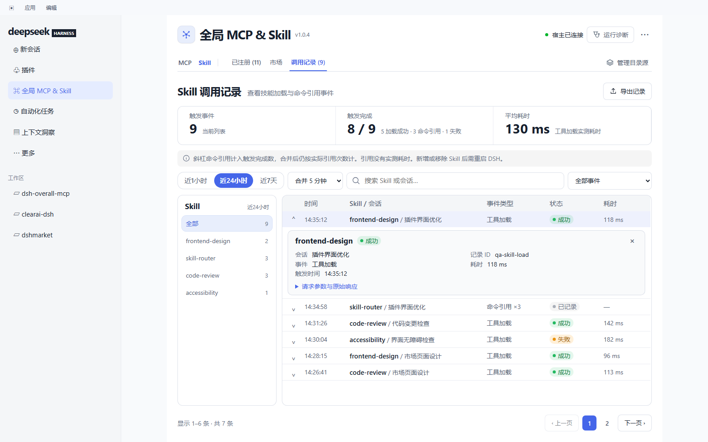

<p align="center">
 
</p>

<h1 align="center">全局 MCP &amp; Skill</h1>

<p align="center"><a href="README.zh-CN.md">中文</a> | English</p>

<p align="center">
 <a href="CHANGELOG.md"></a>
 <a href="LICENSE"></a>
 =24">
</p>

**Manage MCP servers and Skills in DeepSeek Harness: discover local capabilities, install from several marketplaces, and inspect actual usage.** Open **全局 MCP & Skill** below Plugins in the sidebar.

## Features

| View | What it provides |
|---|---|
| **MCP · Registered** | Scan host MCP configurations, inspect connections, enable, disable, configure, check, or remove servers. Filter and group by source, with source-wide bulk actions. |
| **MCP · Market** | Search, categorize, bookmark, and install deduplicated entries from the official Registry, Smithery, Docker MCP, GitHub MCP, Awesome Remote, and Awesome List. |
| **Skill · Registered** | Read `$DSH_HOME/skills`, `~/.agents/skills`, `~/.claude/skills`, and `~/.codex/skills`. Inspect descriptions, origins, files, and directories, with search, sorting, and an alphabet index. |
| **Skill · Market** | Browse ClawHub, Anthropic official skills, Tencent SkillHub official skills, SkillHub, and GitHub. Use a local index, categories, source filters, popularity ranking, and installation. |
| **MCP · Calls** | Inspect tool requests, responses, outcomes, latency, and connection failures over the last hour, 24 hours, or 7 days. |
| **Skill · Calls** | Inspect tool loads and slash-command references, filter events, fold repeated references, and page through results. References count with their actual multiplicity; latency averages only measured tool loads. |

Both Registered lists default to 20 entries and offer **20 / 50 / 100** per page. MCP and Skill share one navigation row and preserve the selected view type when switching.

In the Skill market and Registered list, click a skill name to open its source page when one is available. **查看** still opens the local skill details.

The Tencent SkillHub official source reads the [open-source Skill directories](https://github.com/Tencent/skillhub/tree/main/skills) separately from the SkillHub platform. Combined results prefer the repository copy when both sources list the same Skill.

### Counters and ranking

- Stars and download counts can refresh. Opening or paging measures supported counters for the visible items, with a five-minute cache for successful measurements. Manual refresh bypasses that cache.
- Rate limits, network failures, or missing fields retain earlier values with a visible error and measurement time. Old values are not presented as a successful refresh.
- Skills default to popularity order. Only SkillHub downloads and Stars receive a **30%** ranking weight; in the all-sources popularity view, SkillHub entries start at rank **21**. If fewer than 20 other-source entries match, SkillHub entries remain withheld from that view and can be accessed through the source filter. A SkillHub-only filter does not reserve those positions, and displayed counters retain their original values.
- Global popularity uses the local index plus measured updates. It does not claim that every marketplace entry is refreshed simultaneously.
- The Calls rail includes only resources with actual events **inside the selected time window**. Names, counts, and scope labels agree. Export covers the current filtered results within the host's retained records.

## Screenshots

These images render the current `client/client.js` in the real React runtime using fixed example data. They do not contain personal sessions or live marketplace measurements.

### MCP · Registered

Connection state, source, and actions share a compact list; details open on demand, with page-size controls below.


### MCP · Market


### MCP · Detail


### Skill · Registered


### Skill · Market


### MCP · Calls


### Skill · Calls



## Install and update

Requires **Node.js `^22.19.0 || >=24.0.0`** and DeepSeek Harness.

```sh
git clone https://github.com/YunzhouLi-hub/dsh-overall-mcp.git
dsh plugin --profile <profile> add /path/to/dsh-overall-mcp
```

Replace `<profile>` with your DSH profile name and the directory with your local checkout, then restart DSH. Update a checkout with `git pull` and a restart. Packages installed through npm can use the panel's self-update action. Updating GitHub code does not publish an npm package.

**The host loads Skills when a session starts.** After adding or removing a Skill, restart DSH and use a new session. Discovery does not mean a running session has loaded it; Skills have no enable switch.

## Local index and network access

Once collected, a Skill index supports local search, categories, sorting, and paging. **Installation still downloads files, and counter refresh still contacts providers.** Refreshing a page does not crawl the entire market. Use source management to collect the full index again when needed.

The index records received rows, source cursors, sample/full modes, and incomplete coverage. It is a cache, not a live mirror. An October 2026 collection measured 214,747 rows, including 205,037 from SkillHub; those are historical measurements, not today's marketplace totals.

GitHub authentication is optional. Detect an existing `gh` login or configure a Token in GitHub access settings for a larger allowance. GitHub's response determines the actual quota and reset time. Source failures show a Chinese explanation with expandable original diagnostics.

## Data and directories

Plugin data lives in `$DSH_HOME/overall-mcp/`, defaulting to `~/.dsh/overall-mcp/` when `DSH_HOME` is unset.

| File or directory | Contents |
|---|---|
| `registry.json` | Registered servers, origins, and configuration. |
| `catalog-cache.json` | Cached MCP catalogs. |
| `skills-index.json` | Skill index, source cursors, and coverage notes. |
| `github-auth.json` | Locally saved GitHub credentials, never returned to the panel in plain text. |
| `calls.jsonl` | Bounded call records; reference folding happens on read without rewriting event timestamps. |
| `ui-prefs.json` | View preferences such as the reference-folding window. |
| `events.ndjson` | Operation and source-request diagnostics. |
| `skills-trash/` | Recovery directory for removed Skills. |

The plugin reads existing host MCP configurations without rewriting those files. New Skills go into `$DSH_HOME/skills/<name>/`, with the exact path shown after installation. Removing a Skill moves it into the plugin's recovery directory.

## Development and verification

GitHub main uses a compact publishing tree containing runtime code, READMEs, the changelog, and screenshots. Tests and image-generation tools remain in the development checkout. UI, counters, call-window behavior, and security fixes have regression checks. See [CHANGELOG.md](CHANGELOG.md) for changes.

## License

[MIT](LICENSE). Marketplace entries and their contents retain their respective licenses.
