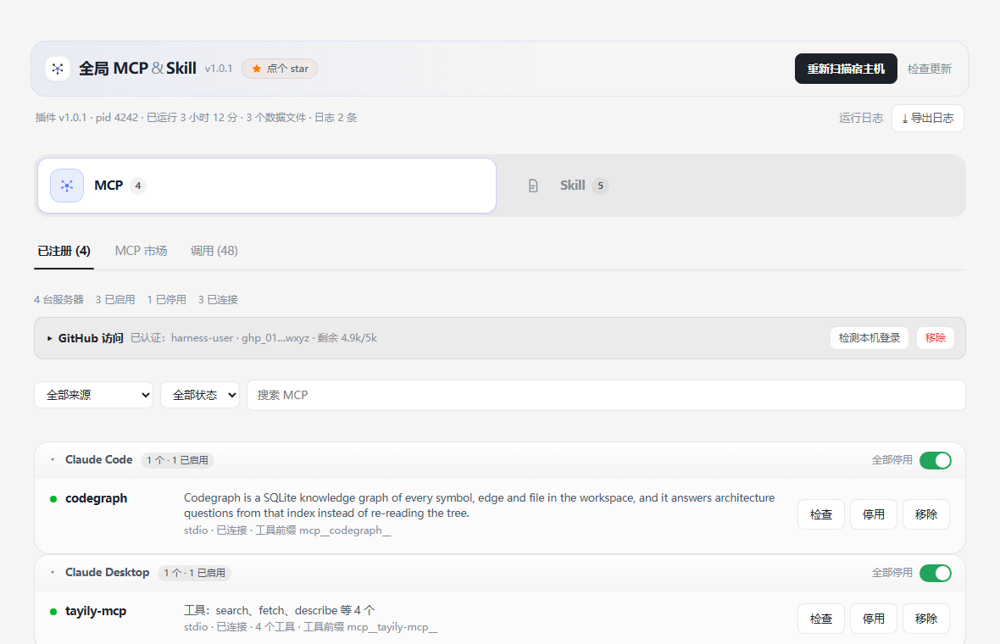
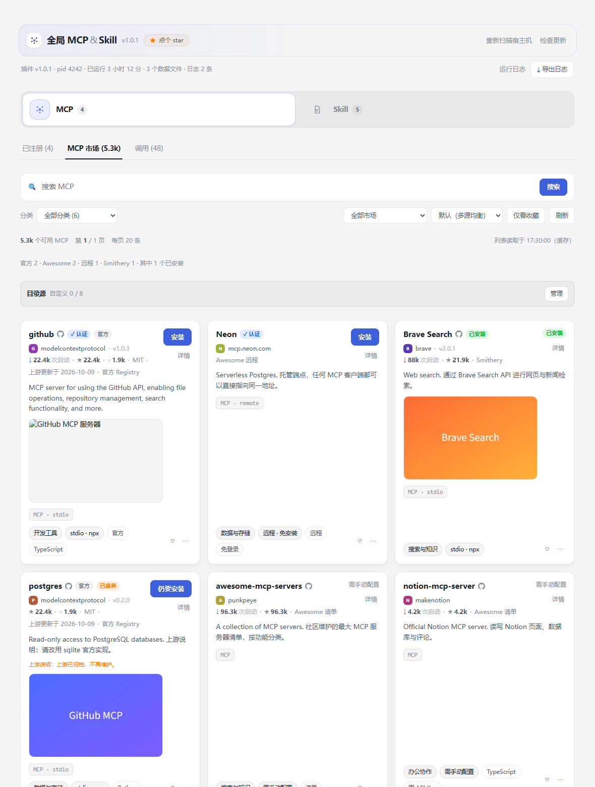
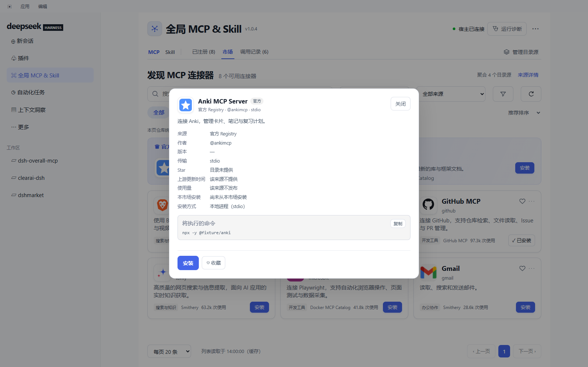
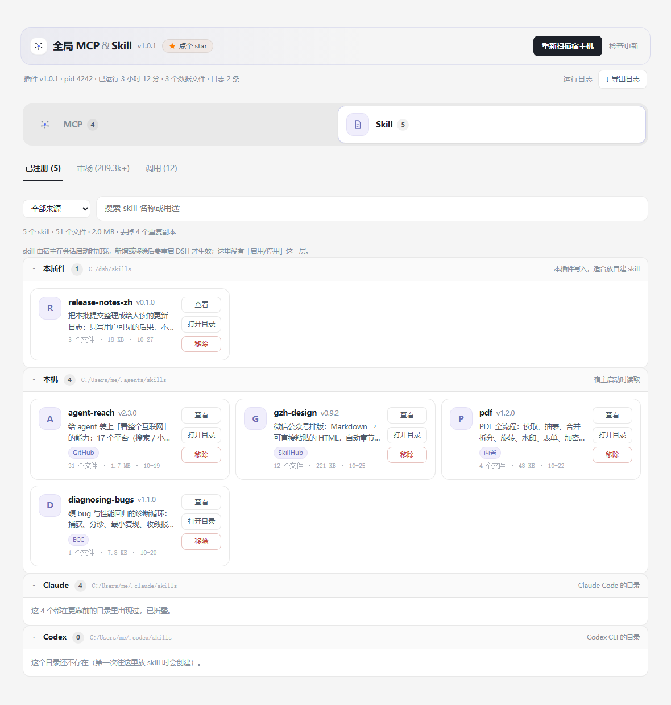
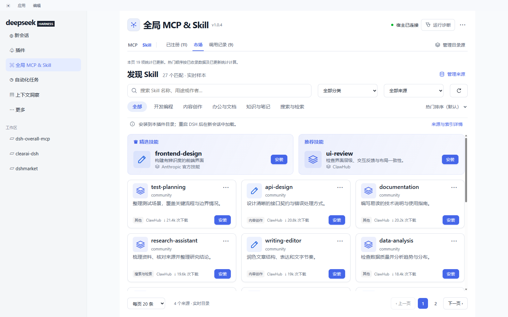
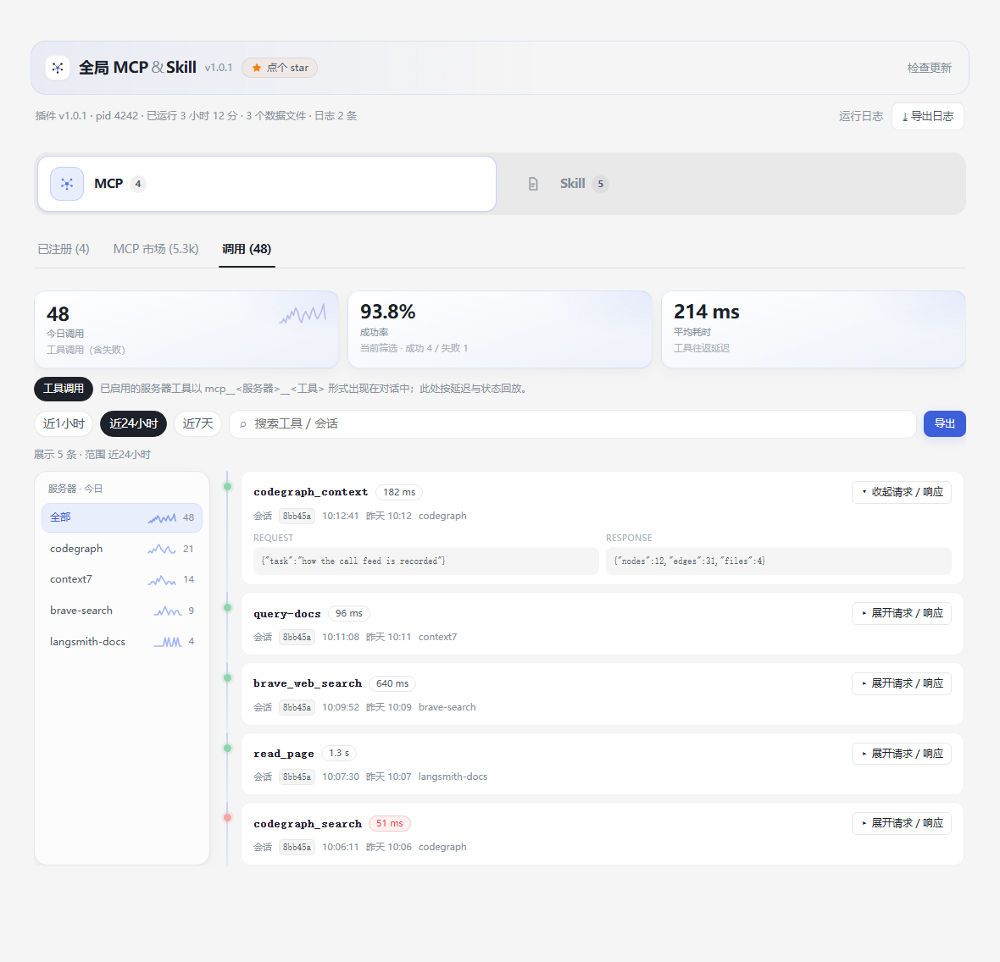
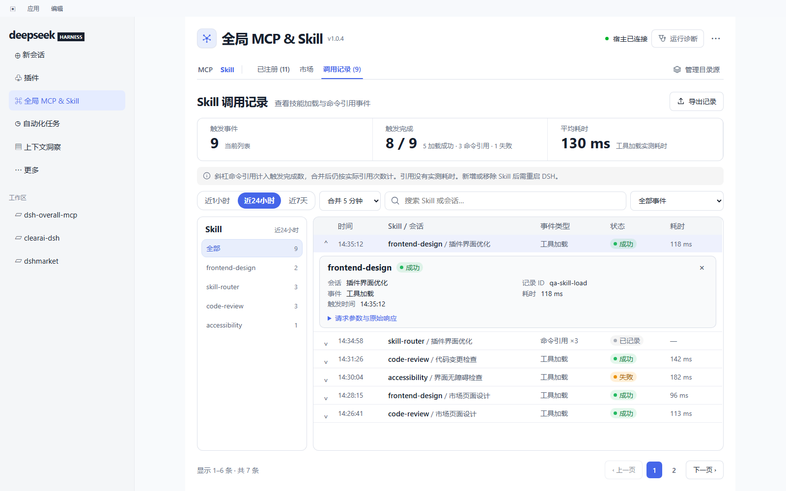

<p align="center">
 
</p>

<h1 align="center">全局 MCP &amp; Skill</h1>

<p align="center">中文 | <a href="README.md">English</a></p>

<p align="center">
 <a href="CHANGELOG.md"></a>
 <a href="LICENSE"></a>
 =24">
</p>

**在 DeepSeek Harness 中统一管理 MCP 与 Skill：发现本机已有能力，从多个市场安装，并查看实际调用记录。** 入口位于侧栏「插件」下方。


适配目标：**DSH 0.2.2-rc.5**。调用记录及运行日志保存失败会单独提示，可重试待写内容；损坏的接口响应会显示错误，不再伪装为空列表。

## 功能

| 页面 | 可以做什么 |
|---|---|
| **MCP · 已注册** | 扫描宿主机 MCP 配置，查看连接状态，启用、停用、配置、检查或移除服务器。支持来源筛选、分组和按来源批量操作。 |
| **MCP · 市场** | 聚合官方 Registry、Smithery、Docker MCP、GitHub MCP、Awesome 远程与 Awesome 清单，去重后搜索、分类、收藏和安装。 |
| **Skill · 已注册** | 扫描 `$DSH_HOME/skills`、`~/.agents/skills`、`~/.claude/skills`、`~/.codex/skills`，查看说明、来源、文件和目录。支持搜索、排序与字母定位。 |
| **Skill · 市场** | 浏览 ClawHub、Anthropic 官方技能、SkillHub 和 GitHub；支持本地索引、分类、来源筛选、热门排序与安装。 |
| **MCP · 调用记录** | 查看工具请求与响应、成功或失败、耗时及连接异常，按近 1 小时、24 小时或 7 天筛选。 |
| **Skill · 调用记录** | 查看工具加载与斜杠命令引用，筛选事件、合并重复引用并分页查看。引用按实际次数计入触发完成数，平均耗时只统计有实测时长的工具加载。 |

两个「已注册」列表默认每页 20 条，可选择 **20 / 50 / 100** 条。MCP 与 Skill 在同一行切换，并保留当前页面类型。

「已注册 Skill」支持按使用次数和最近使用时间排序，统计近 7 天保留的本机记录，包括成功加载与斜杠引用。同名 Skill 共用统计，暂无记录的排在最后。

在 Skill 市场和「已注册」列表中，有来源网址的技能可点击名称打开原网页。「查看」仍可打开本地技能详情。

### 统计与排序

- Star、下载量等数字会更新。浏览或翻页时测量当前页可获取的统计，成功缓存五分钟；点击刷新会绕过该缓存。
- 上游限流、网络异常或统计字段缺失时，保留已有数字并显示失败提示和测量时间，不把旧数字当作刷新成功。
- Skill 默认按热门排序，SkillHub 的下载量与 Star 按 **30%** 计入排名，展示数字仍为来源原值。未输入关键词且浏览全部来源时，SkillHub 从第 **21** 位起参与展示。其他来源不足 20 条时，可通过 SkillHub 来源筛选查看。使用关键词搜索时，所选来源的所有匹配结果都参与排序和分页。
- Skill 市场的 GitHub 来源内置 Superpowers，以及 OpenAI、Vercel、Notion、n8n、Expo、Chrome DevTools、Supabase、Stripe、Gemini 和 Hugging Face 发布的技能。可按仓库名或技能名搜索，已有索引也直接可见。每项都链接到上游技能目录，安装以该目录为单位。套件的联动配置见上游仓库说明。
- 全局热门顺序依据本地索引及已更新统计，不代表整个市场的所有条目同时实时刷新。
- 调用页左侧只列出**所选时间范围内实际有事件**的连接器或 Skill，名称、计数和范围标签保持一致。导出内容是当前筛选结果，受宿主保留记录范围限制。

## 界面预览

以下图片由当前 `client/client.js` 在真实 React 运行时中渲染，使用固定示例数据；不是个人会话或线上统计快照。

### MCP · 已注册

连接状态、来源和操作集中在列表中，详情按需展开，底部可选择每页条数。



### MCP · 市场



### MCP · 详情



### Skill · 已注册



### Skill · 市场



### MCP · 调用记录



### Skill · 调用记录



## 安装与更新

需要 **Node.js `^22.19.0 || >=24.0.0`** 和 DeepSeek Harness。

```sh
dsh plugin --profile desktop add "github:YunzhouLi-hub/dsh-overall-mcp#main"
```

正式安装或升级请用 DSH 安装完整的 GitHub 插件包（可在 `#` 后指定提交），然后完全退出并重开 DSH。不要手动覆盖托管配置的 `node_modules` 中的个别文件；DSH 更新时可能从锁文件恢复旧版。开发请使用独立配置。

运行命令前请完全退出 DSH。如果你使用其他配置，将 `desktop` 换成对应配置名。通过 npm 安装的插件可使用面板自更新。GitHub 上的代码更新与 npm 发包是两件独立的事。

MCP 和 Skill 页面分别提供「检查 MCP 更新」与「检查 Skill 更新」。Skill 检查逐份核对已安装的市场技能。GitHub 技能安装时会记录实际下载的提交，缺少可核对凭据的旧安装会说明跳过原因。右上角「插件操作」里的「检查插件更新」只检查插件本身，GitHub 安装和官方安装包都会查询正式 Release。

**Skill 在会话启动时由宿主加载。** 新增或移除后需重启 DSH，并在新会话中使用；已注册列表不表示当前会话已经加载，也没有 Skill 启用开关。

## 本地索引与网络

收录索引后，Skill 的搜索、分类、排序和分页可以读取本机文件。**安装仍需下载文件，统计刷新仍需访问来源接口。** 点击刷新当前页不会重爬整个市场；需要更新整份索引时，可在「管理来源」中重新收录。

索引记录实际收到的条目数、来源游标、切片或全量模式，以及未能完整遍历的范围。它是缓存，不是上游目录的实时镜像。2026 年 10 月的一次采集得到 214,747 行，其中 SkillHub 为 205,037 行；这些是历史测量，不是当前市场总数。

GitHub 登录是可选的。可在 GitHub 访问设置中检测本机 `gh` 登录或配置 Token，提高可用额度；实际额度与恢复时间以 GitHub 返回为准。来源不可用时显示中文原因，并保留可展开的原始诊断。

## 数据与目录

插件数据位于 `$DSH_HOME/overall-mcp/`，未设置 `DSH_HOME` 时默认为 `~/.dsh/overall-mcp/`。

| 文件或目录 | 内容 |
|---|---|
| `registry.json` | 已注册服务器、来源和配置。 |
| `catalog-cache.json` | MCP 目录缓存。 |
| `skills-index.json` | Skill 本地索引、来源游标和覆盖说明。 |
| `github-auth.json` | 本机保存的 GitHub 访问凭据；不通过页面返回明文。 |
| `calls.jsonl` | 有界调用记录；重复引用在读取时合并，不重写原事件时间。 |
| `ui-prefs.json` | 页面偏好，例如命令引用合并窗口。 |
| `events.ndjson` | 操作和来源请求诊断。 |
| `skills-trash/` | 移除 Skill 时的回收目录。 |

插件读取宿主机已有 MCP 配置，不改写原配置文件。新 Skill 安装到 `$DSH_HOME/skills/<名字>/`，安装结果会说明确切路径；移除 Skill 会移动到插件回收目录。

## 开发与验证

GitHub 的 main 包含运行代码、文档、截图和发布版离线检查。工作流会验证包完整性及部分 Skill、更新和界面流程。开发检出可用 `npm run verify:ci` 跑完整离线验证，实时目录探针用 `npm run test:catalog-live` 单独运行。更新说明见 [CHANGELOG.md](CHANGELOG.md)。

## 许可证

[MIT](LICENSE)。各市场条目及其内容遵循各自许可证。
